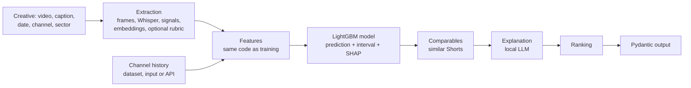

# galaxies-creative-performance-predictor

[Português](README.md) · English

Agent that predicts, before publication, how many likes a fashion, beauty or automotive YouTube Short will get relative to its own channel's history, with an interval, a low-confidence flag, a ranking across creatives and an explanation. An Inteli Academy × Galaxies project.

The number comes from a model trained offline on real Shorts; the LLM only orchestrates and explains, and never guesses the number. The tool is exposed as a Python function and as an MCP server, for Galaxies' synthetic persona to consume.

## Problem and scope

Galaxies simulates consumer segments with synthetic personas, which today give qualitative feedback on campaign creatives. This project delivers the statistical component: given a creative that has not been published yet, predict how the real audience will react to it and with what margin of error, so the error can be measured after publication.

Scope:

- **Platform**: YouTube Shorts, through the YouTube Data API v3 (official and free).
- **Sectors**: fashion, beauty and automotive, with brand and creator channels.
- **Region**: Brazil is the focus and the only test set; global channels are used for training only.
- **Metric**: likes relative to the channel's own median. Views were left out: YouTube changed how Shorts views are counted on 03/31/2025 (every play or replay now counts), and brand channel views include paid media.
- **Prediction time**: before publication, without any metric from the post itself.

## Dataset

Full dataset card in [`docs/dataset.en.md`](docs/dataset.en.md); exploratory analysis in [`notebooks/01_eda.ipynb`](notebooks/01_eda.ipynb) (in Portuguese).

- **Source**: YouTube Data API v3 (each channel's Shorts playlist, video details and channel statistics), collected on 10/13/2026.
- **Period**: Shorts published from 10/15/2024 (when Shorts started accepting up to 3 minutes) to 08/28/2026 (at least 30 days before collection, with settled metrics).
- **Volume**: 87 training channels (60 from Brazil) and 13 demo channels; 30,187 Shorts in the window, 29,916 with a target. The multimodal part (video, audio and attributes from a vision model) covers 9,665 Shorts from a sample of 9,769 (up to 120 per channel, spread over time; the rest went offline), 9,640 of them with the extractor rubric.
- **License and use**: the data follows the YouTube API Services Terms of Service, and the videos belong to their channels. The repository does not redistribute media, API responses or the collected tables; it keeps the channel list, the code that redoes the collection, and aggregated results.
- **What the dataset does not represent**: other platforms, paid ads (channels with obvious boosting were left out), metrics other than likes, every brand in each sector (GAC, GWM, Renner, C&A and Shein Brasil have no active official Shorts channel), and how each post evolves over time.

## Architecture

Full documentation: [`docs/architecture.en.md`](docs/architecture.en.md) (context, containers, pipeline, invariants and decisions), [`docs/agent.en.md`](docs/agent.en.md) (the agent graph, node by node) and the model card, [`docs/model.en.md`](docs/model.en.md).



- `creative_predictor.collect`: channel curation, metadata collection and video download.
- `creative_predictor.features`: target, channel history, text, frames, transcript, visual and audio measures, embeddings and the vision model rubric.
- `creative_predictor.model`: modeling table, metrics, baselines and experiments.
- `creative_predictor.predict`: saved model, Pydantic contract and the prediction function.
- `creative_predictor.agent`: LangGraph agent (graph diagram: `uv run python -m creative_predictor.agent.graph --mermaid`).
- `creative_predictor.mcp_server`: MCP server.

The new creative enters as one more row in the channel's history and goes through the same functions that built the training dataset, so the prediction features are the same as in training (checked on real Shorts).

## Installation and usage

Requirements:

- [uv](https://docs.astral.sh/uv/) and Python 3.12 (`uv sync` installs the dependencies).
- macOS: LightGBM needs the system OpenMP library:
  ```bash
  brew install libomp
  ```
- `ffmpeg` on the PATH, for frames and audio.
- [Ollama](https://ollama.com) with `gemma4:12b`, for the text explanation (optional: without it, the explanation uses a default text).
- Keys in `.env` (template in `.env.example`): `YOUTUBE_API_KEY` to collect data and fetch the history of new channels; `GEMINI_API_KEY` only to redo the attribute extraction.

Predicting a creative (Python):

```python
from datetime import datetime
from creative_predictor.predict.schemas import ChannelInfo, CreativeInput
from creative_predictor.predict.service import predict_creative

prediction = predict_creative(
    CreativeInput(
        creative="campaign/outfit_of_the_day.mp4",  # optional: without video, metadata and text only
        caption="Look do dia: jeans, camisa branca e tênis",
        planned_datetime=datetime(2026, 10, 20, 18, 0),  # channel's local time
        sector="moda",
        channel=ChannelInfo(channel_id="UC..."),
        use_vlm=False,  # True sends frames and transcript to Google's API (rubric)
    )
)
print(prediction.predicted_metric, prediction.interval_low, prediction.interval_high)
print(prediction.blocks_used, prediction.top_drivers[0].label)
```

Full agent (extraction, prediction, comparables, explanation and ranking):

```python
from creative_predictor.agent.graph import analyze

ranking = analyze([creative_a, creative_b])
```

MCP server (stdio or HTTP):

```bash
uv run python -m creative_predictor.mcp_server
uv run python -m creative_predictor.mcp_server --http 8000
```

Demo with channels outside training (report in `reports/demo.md`):

```bash
uv run python -m creative_predictor.demo
```

Redo everything from the collection:

```bash
uv run python -m creative_predictor.collect.shorts                     # metadata
uv run python -m creative_predictor.collect.media                      # videos
uv run python -m creative_predictor.features.extract local --follow    # frames, transcript, signals
uv run python -m creative_predictor.features.extract embed --follow    # embeddings
uv run python -m creative_predictor.features.extract vlm --follow      # vision model rubric
uv run python -m creative_predictor.model.train --text-embeddings      # metadata and text experiments
uv run python -m creative_predictor.model.multimodal                   # gain per block
uv run python -m creative_predictor.predict.bundle                     # saved model
```

## Models and settings

- **Target**: `log((likes + 1) / (median + 1))`, with the median likes of the channel's 20 Shorts published at least 30 days earlier. The 30-day gap ensures the history only has settled likes, the same ones available when predicting a new creative.
- **Model**: LightGBM with Huber loss (chosen on validation), early stopping on the temporal validation set, and refitting on every Short for the saved model. A single model with every block: since most of the dataset has no extracted video, it learns with empty fields and predicts creatives with text only, with video and no rubric, or with everything.
- **Rubric at prediction time**: optional (`use_vlm`). It sends frames and transcript to Google's free API, which may use the data for training; for confidential creatives, the prediction uses the signals and embeddings, computed locally.
- **80% interval**: quantile regression (P10 and P90) with conformal calibration (CQR) on validation.
- **Interval for risky Shorts**: stale history (reference Shorts older than 180 days, in median) and a declining channel (the 5 latest settled Shorts below ~60% of the median and fewer posts in the last 90 days) get their own conformal margin, calibrated on them only: the model errs more in these cases.
- **Low-confidence flag**: channel with fewer than 10 settled Shorts, interval wider than 80% of the validation ones, channel outside the training dataset, stale history or declining channel. Thresholds were chosen on validation ([`model/confidence.py`](src/creative_predictor/model/confidence.py)).
- **Features**, in blocks:
  - metadata: channel history (size, recent performance, posting rhythm, usual duration, age), format (duration, category), local time, text counts and title embedding;
  - video and audio signals: brightness, contrast, saturation, colorfulness, faces (YuNet), on-screen text (EasyOCR), motion, scene cuts (ffmpeg), audio energy and silence, speech density (faster-whisper);
  - embeddings: frames, audio and transcript with EmbeddingGemma 2, reduced with PCA;
  - vision model rubric: hook, face, product, text and editing, audio, aesthetics and message, with per-sector adaptations, answered by `gemma-4-31b-it` from 8 frames and the transcript.
- **Extractor choice**: benchmark on 28 Shorts against the reference `gemini-3.5-flash-lite` with the full video ([`reports/vlm_benchmark.csv`](reports/vlm_benchmark.csv)). `gemma-4-31b-it` was the closest to the reference and has open weights: the public dataset goes through the free API, and Galaxies can run the same model locally with unpublished creatives.
- **Agent**: LangGraph with the local `gemma4:12b` (configurable through `CREATIVE_PREDICTOR_LLM`).
- **Experiment tracking**: MLflow (`mlflow.db` at the root) and summaries in `reports/`.

## Methodology

- **Hypothesis**: the creative's content (text, video and audio) improves the ranking between Shorts of the same channel beyond what the channel's history explains. Null hypothesis: a model with only the channel history ranks just as well. Test: the same model with and without each content block, on the same subset of the temporal test set, with a bootstrap confidence interval over channels.
- **Temporal split** (main): training up to February 2026, validation from March to May, test from June to August with Brazilian channels only.
- **Channel split**: Brazilian channels split into 5 groups, each one left out of training in turn, to measure performance on unseen channels; the 13 demo channels complete this evaluation.
- **Baselines**: the channel's historical median (prediction equal to the median), the channel's recent mean, and a regression of likes on subscribers.
- **Metrics**: MAE in log, MAPE, global and within-channel Spearman, pairwise accuracy between Shorts of the same channel, F1 on the bands (below, average, above, viral), interval coverage.
- **Multimodal gain**: cumulative blocks compared on the same test subset where every block exists.

## Results

Temporal test: Shorts from Brazilian channels published from June to August 2026 (2,821 Shorts from 58 channels), never seen in training or validation. Full analysis in [`notebooks/02_resultados.ipynb`](notebooks/02_resultados.ipynb) (in Portuguese); records in MLflow and in [`reports/`](reports/).

### Gain per block

On the 899 test Shorts with every block extracted ([`reports/multimodal_results.csv`](reports/multimodal_results.csv)):

| Model | MAE log | Within-channel Spearman | Pairwise |
|---|---:|---:|---:|
| Baseline: channel median | 0.727 | n/a | 0.500 |
| Metadata and text | 0.683 | 0.315 | 0.622 |
| + video and audio signals | 0.686 | 0.350 | 0.629 |
| + embeddings (frames, audio, transcript) | 0.673 | 0.371 | 0.644 |
| + extractor rubric (final model) | **0.672** | **0.392** | **0.648** |
| Final model, without the rubric at prediction time | 0.680 | 0.358 | 0.646 |

With a bootstrap over channels (90% interval), the final model beats the metadata and text model by +0.025 in pairwise accuracy (+0.005 to +0.048) and +0.080 in within-channel Spearman (+0.045 to +0.116): the null hypothesis is rejected for ranking. In absolute error, the improvement (−0.011) is not significant. The rubric alone, on top of the signals and embeddings, adds little (+0.021 in Spearman, from −0.002 to +0.042).

### Full test set and unseen channels

| Model | MAE log | Within-channel Spearman | Pairwise |
|---|---:|---:|---:|
| Baseline: channel median | 0.702 | n/a | 0.500 |
| Metadata and text | 0.658 | 0.336 | 0.612 |
| Final model (every block) | 0.653 | 0.375 | 0.620 |
| Metadata and text, unseen channels | 0.689 | 0.275 | 0.593 |

In the full test set, only a third of the Shorts have extracted video; the rest are predicted with metadata and text only.

### Trained model × LLM without a model

The agent's LLM (`gemma4:12b`) received, for each Short, the 8 frames, the title, the duration, the transcript, the channel median and the channel's latest Shorts with their likes, and guessed the likes ([`model/llm_baseline.py`](src/creative_predictor/model/llm_baseline.py)). On the same 198 test Shorts:

| Model | MAE log | Within-channel Spearman | Pairwise |
|---|---:|---:|---:|
| Baseline: channel median | 0.776 | n/a | 0.500 |
| LLM without a model | 1.127 | 0.014 | 0.504 |
| Trained model | **0.701** | **0.422** | **0.668** |

The LLM errs more than the channel median and ranks Shorts of the same channel at chance level; the trained model gets two out of three pairs right.

### Interval, confidence and explanation

- **80% interval**: 79.7% coverage on the test set (75.8% without calibration). On risky Shorts (12% of the test set), 78.0% with their own margin, against 71.7% with the single margin. On unseen channels, 78.2%. By sector: automotive 76.9%, beauty 82.1%, fashion 80.1%.
- **Low confidence**: flags 29.8% of the test set. Flagged Shorts err more (MAE 0.886, against 0.554 for the rest); those with stale history, twice as much (1.23).
- **Agent explanations**: in 100 automatically checked explanations ([`agent/faithfulness.py`](src/creative_predictor/agent/faithfulness.py)), none of the 521 cited numbers was missing from the data received, all of them cite model factors, and every low-confidence one says so.

### Where the model errs

- **Sector**: fashion is the most predictable (pairwise 0.657), beauty the least (0.592).
- **Channel type**: brands (0.559) err more than creators (0.644).
- **Largest errors**: boosted brand campaigns (Renault at 274× the channel median, Dove at 127×), explained by paid media that the data does not show.
- **Factors**: the channel history dominates the prediction (mean absolute contribution of 0.82 in log, against 0.10 for embeddings, 0.05 for signals and 0.03 for the rubric).
- **Demo** with 13 channels outside training (the 5 latest Shorts of each, predicted as if unpublished): 77 of 114 pairs in the right order (68%), in line with the test set. Only 27 of the 61 real like counts fall inside the 80% interval: several of these channels have stale history, the case where the model errs the most ([`reports/demo.md`](reports/demo.md)).

## Limitations

- The target predicts likes at about 90 days; the API gives a single reading per video, so there is no first-week prediction.
- Paid media: even with boosted channels left out of the dataset, boosted brand campaigns are the model's largest errors.
- Stale history: when a channel stopped posting for a long time, the reference median comes from another period, and the error doubles. This is the case for several demo channels, which stayed out of training precisely because they post little. These Shorts are flagged as low confidence and get a wider interval, but the model does not correct each channel's bias.
- The Shorts playlist used in the collection is not documented by the API.
- Subscribers are those on the collection date, not on the publication date; that is why the model uses the like history, and subscribers only feed the baseline.
- Global channels without a declared country use UTC for local time.
- The multimodal part covers a sample of up to 120 Shorts per channel: 32% of the training rows have extracted video. The extractor's free quota (1 to 4 videos per minute) and YouTube blocks every ~500 downloads limited the volume.
- On macOS, LightGBM and PyTorch don't coexist in the same process; video extraction and prediction embeddings run in a subprocess.
- Prediction time with video: ~30 s of local extraction per creative (plus loading the models on the first call); with the rubric, another 1 to 10 minutes waiting for the free API.

## Next steps

- Correct the bias of channels with stale history (for example, a time-weighted median).
- Extract video for the whole dataset, not only the sample, so the model learns more from content.
- Comparables by visual embedding, not only by title (search over the vectors already computed).
- Rebuild the global part of the dataset around communities that influence Brazilian content.
- Dynamic training: receive a client's ad dataset in the same schema and train a specialist model.
- Simulation of variations (caption, time, duration) re-scored by the model before publishing.
