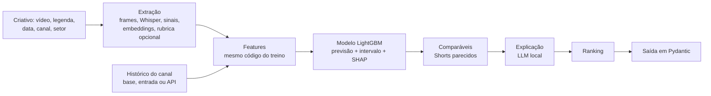

# galaxies-creative-performance-predictor

Português · [English](README.en.md)

Agente que prevê, antes da publicação, quantas curtidas um YouTube Short de moda, beleza ou automotivo vai receber em relação ao histórico do próprio canal, com intervalo, sinal de baixa confiança, ranking entre criativos e explicação. Projeto Inteli Academy × Galaxies.

O número vem de um modelo treinado offline sobre Shorts reais; o LLM só orquestra e explica, nunca chuta o número. A ferramenta é exposta como função Python e como servidor MCP, para a persona sintética da Galaxies consumir.

## Problema e recorte

A Galaxies simula segmentos de consumidores com personas sintéticas, que hoje dão feedback qualitativo sobre criativos de campanha. Este projeto entrega o componente estatístico: dado um criativo ainda não publicado, prever como o público real vai reagir a ele e com que margem de erro, de forma que o erro possa ser medido depois da publicação.

Recorte:

- **Plataforma**: YouTube Shorts, pela YouTube Data API v3 (oficial e gratuita).
- **Setores**: moda, beleza e automotivo, com canais de marcas e de criadores de conteúdo.
- **Região**: o Brasil é o foco e o único conjunto de teste; canais globais entram só no treino.
- **Métrica**: curtidas em relação à mediana do próprio canal. Views ficaram de fora: o YouTube mudou a contagem de views de Shorts em 31/03/2025 (cada play ou repetição passou a contar), e as views de canais de marca incluem mídia paga.
- **Momento da previsão**: antes da publicação, sem nenhuma métrica do próprio post.

## Base

Ficha completa em [`docs/dataset.md`](docs/dataset.md); análise exploratória em [`notebooks/01_eda.ipynb`](notebooks/01_eda.ipynb).

- **Origem**: YouTube Data API v3 (playlist de Shorts de cada canal, detalhes dos vídeos e estatísticas dos canais), coletada em 13/10/2026.
- **Período**: Shorts publicados de 15/10/2024 (quando os Shorts passaram a aceitar até 3 minutos) a 28/08/2026 (pelo menos 30 dias antes da coleta, com métricas estabilizadas).
- **Volume**: 87 canais de treino (60 do Brasil) e 13 de demonstração; 30.187 Shorts na janela, 29.916 com alvo. A parte multimodal (vídeo, áudio e atributos por modelo de visão) cobre 9.662 Shorts de uma amostra de 9.769 (até 120 por canal, espalhados no tempo; os demais saíram do ar ou seguiram bloqueados pelo YouTube), 9.648 deles com a rubrica do extrator.
- **Licença e uso**: os dados seguem os Termos de Serviço dos serviços de API do YouTube, e os vídeos pertencem aos canais. O repositório não redistribui mídia, respostas da API nem as tabelas coletadas; guarda a lista de canais, o código que refaz a coleta e resultados agregados.
- **O que a base não representa**: outras plataformas, anúncios pagos (canais com impulsionamento evidente ficaram de fora), métricas além de curtidas, todas as marcas do setor (GAC, GWM, Renner, C&A e Shein Brasil não têm canal oficial ativo de Shorts) e a evolução de cada post no tempo.

## Arquitetura

Documentação completa: [`docs/architecture.md`](docs/architecture.md) (contexto, contêineres, pipeline, invariantes e decisões), [`docs/agent.md`](docs/agent.md) (o grafo do agente, nó a nó) e o model card, [`docs/model.md`](docs/model.md).



- `creative_predictor.collect`: curadoria de canais, coleta de metadados e download dos vídeos.
- `creative_predictor.features`: alvo, histórico do canal, texto, frames, transcrição, medidas visuais e de áudio, embeddings e a rubrica do modelo de visão.
- `creative_predictor.model`: tabela de modelagem, métricas, baselines e experimentos.
- `creative_predictor.predict`: modelo salvo, contrato em Pydantic e a função de previsão.
- `creative_predictor.agent`: agente em LangGraph (diagrama do grafo: `uv run python -m creative_predictor.agent.graph --mermaid`).
- `creative_predictor.mcp_server`: servidor MCP.
- `creative_predictor.app`: tela de demonstração em Streamlit.

O criativo novo entra como mais uma linha no histórico do canal e passa pelas mesmas funções que montaram a base de treino; assim as features da previsão são as mesmas do treino (conferido em Shorts reais).

## Instalação e execução

Requisitos:

- [uv](https://docs.astral.sh/uv/) e Python 3.12 (`uv sync` instala as dependências).
- macOS: a LightGBM precisa da biblioteca OpenMP do sistema:
  ```bash
  brew install libomp
  ```
- `ffmpeg` no PATH, para frames e áudio.
- [Ollama](https://ollama.com) com `gemma4:12b`, para a explicação em texto (opcional: sem ele, a explicação usa um texto padrão).
- Chaves no `.env` (modelo em `.env.example`): `YOUTUBE_API_KEY` para coletar e buscar o histórico de canais novos; `GEMINI_API_KEY` só para refazer a extração de atributos.

Instalação e modelo treinado:

```bash
uv sync
uv run python -m creative_predictor.predict.bundle --download
```

O modelo (2,8 MB) vem anexado à [release do GitHub](https://github.com/gnfes/galaxies-creative-performance-predictor/releases); o comando confere o hash antes de gravá-lo em `data/models/`. A base coletada não vai para o repositório: sem ela, o histórico de cada canal vem da API do YouTube (`YOUTUBE_API_KEY`), e os Shorts parecidos e a demonstração com canais fora do treino ficam indisponíveis. Na primeira previsão, o EmbeddingGemma 2 é baixado do Hugging Face (cerca de 3 GB).

Previsão de um criativo (Python):

```python
from datetime import datetime
from creative_predictor.predict.schemas import ChannelInfo, CreativeInput
from creative_predictor.predict.service import predict_creative

prediction = predict_creative(
    CreativeInput(
        creative="campanha/look_do_dia.mp4",  # opcional: caminho ou URL (inclusive do YouTube)
        caption="Look do dia: jeans, camisa branca e tênis",
        planned_datetime=datetime(2026, 10, 20, 18, 0),  # horário local do canal
        sector="moda",
        channel=ChannelInfo(channel_id="UC..."),
        use_vlm=False,  # True envia frames e transcrição à API do Google (rubrica)
    )
)
print(prediction.predicted_metric, prediction.interval_low, prediction.interval_high)
print(prediction.blocks_used, prediction.top_drivers[0].label)
```

Agente completo (extração, previsão, comparáveis, explicação e ranking):

```python
from creative_predictor.agent.graph import analyze

ranking = analyze([criativo_a, criativo_b])
```

Servidor MCP (stdio ou HTTP):

```bash
uv run python -m creative_predictor.mcp_server
uv run python -m creative_predictor.mcp_server --http 8000
```

Tela de demonstração (Streamlit, dependência opcional `app`): prever um criativo, comparar criativos, ver previsto × real em canais fora do treino e consultar os resultados. Roda localmente e abre no navegador:

```bash
uv sync --extra app
uv run --extra app python -m creative_predictor.app
```

Roteiro de 6 a 8 minutos para apresentar a tela: [`docs/demo-guide.md`](docs/demo-guide.md).

Demonstração com canais fora do treino (relatório em `reports/demo.md`):

```bash
uv run python -m creative_predictor.demo
```

Refazer tudo a partir da coleta:

```bash
uv run python -m creative_predictor.collect.shorts                     # metadados
uv run python -m creative_predictor.collect.media                      # vídeos
uv run python -m creative_predictor.features.extract local --follow    # frames, transcrição, sinais
uv run python -m creative_predictor.features.extract embed --follow    # embeddings
uv run python -m creative_predictor.features.extract vlm --follow      # rubrica do modelo de visão
uv run python -m creative_predictor.model.train --text-embeddings      # experimentos de metadados e texto
uv run python -m creative_predictor.model.multimodal                   # ganho por bloco
uv run python -m creative_predictor.predict.bundle                     # modelo salvo
```

## Modelos e configurações

- **Alvo**: `log((curtidas + 1) / (mediana + 1))`, com a mediana das curtidas dos 20 Shorts do canal publicados pelo menos 30 dias antes. O intervalo de 30 dias garante que o histórico só tenha curtidas estabilizadas, as mesmas que existem ao prever um criativo novo.
- **Modelo**: LightGBM com perda Huber (escolhida na validação), parada antecipada na validação temporal e retreino com todos os Shorts para o modelo salvo. Um modelo só com todos os blocos: como a maior parte da base não tem vídeo extraído, ele aprende com campos vazios e prevê criativos só com texto, com vídeo sem rubrica ou com tudo.
- **Rubrica na previsão**: opcional (`use_vlm`). Ela envia frames e transcrição à API gratuita do Google, que pode usar os dados para treino; para criativos sigilosos, a previsão usa os sinais e os embeddings, calculados localmente.
- **Intervalo de 80%**: regressão quantílica (P10 e P90) com calibração conformal (CQR) na validação.
- **Intervalo nos Shorts de risco**: o histórico desatualizado (Shorts de referência com mais de 180 dias, em mediana) e o canal em queda (os 5 Shorts estabilizados mais recentes abaixo de ~60% da mediana e menos posts nos últimos 90 dias) têm uma folga conformal própria, calibrada só neles: o modelo erra mais nesses casos.
- **Faixas**: abaixo, na média, acima e viral, separadas pelos quantis P25, P75 e P95 do alvo no treino (no modelo salvo, 0,56×, 1,70× e 7,4× a mediana do canal).
- **Sinal de baixa confiança**: canal com menos de 10 Shorts estabilizados, intervalo mais largo que 80% dos da validação, canal fora da base de treino, histórico desatualizado ou canal em queda. Os limites foram escolhidos na validação ([`model/confidence.py`](src/creative_predictor/model/confidence.py)).
- **Features**, em blocos:
  - metadados: histórico do canal (tamanho, desempenho recente, ritmo de postagem, duração habitual, idade), formato (duração, categoria), horário local, contagens do texto e embedding do título;
  - sinais do vídeo e do áudio: brilho, contraste, saturação, colorido, rostos (YuNet), texto na tela (EasyOCR), movimento, cortes de cena (ffmpeg), energia e silêncio do áudio, densidade de fala (faster-whisper);
  - embeddings: frames, áudio e transcrição com o EmbeddingGemma 2, reduzidos por PCA (a thumbnail é baixada, mas não entra no modelo: o visual vem dos 8 frames);
  - rubrica do modelo de visão: gancho, rosto, produto, texto e edição, áudio, estética e mensagem, com adaptações por setor, respondida pelo `gemma-4-31b-it` a partir de 8 frames e da transcrição.
- **Escolha do extrator**: benchmark em 28 Shorts contra a referência `gemini-3.5-flash-lite` com o vídeo inteiro ([`reports/vlm_benchmark.csv`](reports/vlm_benchmark.csv)). O `gemma-4-31b-it` foi o mais próximo da referência e tem pesos abertos. A base pública passou pela API gratuita, e a previsão chama a mesma API; com os pesos abertos, a Galaxies pode rodar o modelo localmente para criativos sigilosos, mas essa troca ainda não está implementada (ver [Evolução](#evolução)).
- **Agente**: LangGraph com o `gemma4:12b` local (configurável por `CREATIVE_PREDICTOR_LLM`).
- **Registro de experimentos**: MLflow local (`mlflow.db` e `mlartifacts/` na raiz, fora do git, recriados ao rodar os experimentos) e resumos versionados em `reports/`.

## Metodologia

- **Hipótese**: o conteúdo do criativo (texto, vídeo e áudio) melhora a ordenação entre Shorts do mesmo canal além do que o histórico do canal explica. Hipótese nula: um modelo só com o histórico do canal ordena tão bem quanto. Teste: o mesmo modelo com e sem cada bloco de conteúdo, no mesmo subconjunto do teste temporal, com intervalo de confiança por bootstrap sobre os canais.
- **Split temporal** (principal): treino até fevereiro de 2026, validação de março a maio, teste de junho a agosto só com canais do Brasil.
- **Split por canal**: canais do Brasil separados em 5 grupos, cada um fora do treino por vez, para medir o desempenho em canais nunca vistos; os 13 canais de demonstração completam essa avaliação.
- **Baselines**: mediana histórica do canal (previsão igual à mediana), média recente do canal e regressão das curtidas sobre os inscritos.
- **Métricas**: MAE em log, MAPE, Spearman global e dentro do canal, acurácia par a par entre Shorts do mesmo canal, F1 nas faixas (abaixo, na média, acima, viral), cobertura do intervalo.
- **Ganho multimodal**: blocos cumulativos comparados no mesmo subconjunto do teste em que todos os blocos existem.

## Resultados

Teste temporal: Shorts de canais do Brasil publicados de junho a agosto de 2026 (2.821 Shorts de 58 canais), nunca vistos no treino nem na validação. Análise completa em [`notebooks/02_resultados.ipynb`](notebooks/02_resultados.ipynb); registros no MLflow e em [`reports/`](reports/).

### Ganho de cada bloco

Nos 899 Shorts do teste com todos os blocos extraídos ([`reports/multimodal_results.csv`](reports/multimodal_results.csv)):

| Modelo | MAE log | Spearman no canal | Par a par |
|---|---:|---:|---:|
| Baseline: mediana do canal | 0,727 | n/a | 0,500 |
| Metadados e texto | 0,683 | 0,315 | 0,622 |
| + sinais do vídeo e do áudio | 0,686 | 0,350 | 0,629 |
| + embeddings (frames, áudio, transcrição) | 0,673 | 0,371 | 0,644 |
| + rubrica do extrator (modelo final) | **0,672** | **0,392** | **0,648** |
| Modelo final, sem a rubrica na previsão | 0,680 | 0,358 | 0,646 |

Com bootstrap sobre os canais (intervalo de 90%), o modelo final ganha do de metadados e texto em +0,025 no par a par (+0,005 a +0,048) e +0,080 no Spearman dentro do canal (+0,045 a +0,116): a hipótese nula é rejeitada para a ordenação. No erro absoluto, a melhora (−0,011) não é significativa. A rubrica sozinha, sobre os sinais e os embeddings, acrescenta pouco (+0,021 no Spearman, de −0,002 a +0,042).

### Teste inteiro e canais nunca vistos

| Modelo | MAE log | MAPE | Spearman global | Spearman no canal | Par a par | F1 nas faixas |
|---|---:|---:|---:|---:|---:|---:|
| Baseline: mediana do canal | 0,702 | 1,22 | 0,862 | n/a | 0,500 | 0,171 |
| Baseline: média recente do canal | 0,798 | 1,62 | 0,828 | −0,158 | 0,434 | 0,210 |
| Baseline: regressão sobre inscritos | 1,564 | 6,90 | 0,383 | 0,259 | 0,595 | 0,209 |
| Metadados e texto | 0,658 | 0,93 | 0,877 | 0,336 | 0,612 | 0,263 |
| Modelo final (todos os blocos) | **0,653** | **0,93** | **0,879** | **0,375** | **0,620** | **0,267** |
| Metadados e texto, canais nunca vistos | 0,689 | 1,05 | 0,869 | 0,275 | 0,593 | 0,222 |

No teste inteiro, só um terço dos Shorts tem vídeo extraído; os demais são previstos só com metadados e texto. O MAPE é o erro percentual médio nas curtidas, puxado por poucos Shorts muito acima do previsto; a mediana desse erro é de 48% no modelo final, contra 54% da mediana do canal. O Spearman global, sobre as curtidas, já chega a 0,86 só com a mediana do canal (acima da faixa de 0,55 a 0,85 citada na literatura): ele mede sobretudo o porte do canal. Por isso a comparação que importa para escolher criativos é a de dentro do canal.

### Modelo treinado × LLM sem modelo

O LLM do agente (`gemma4:12b`) recebeu, para cada Short, os 8 frames, o título, a duração, a transcrição, a mediana do canal e os últimos Shorts do canal com as curtidas, e chutou as curtidas ([`model/llm_baseline.py`](src/creative_predictor/model/llm_baseline.py)). Nos mesmos 198 Shorts do teste:

| Modelo | MAE log | Erro % mediano | Spearman no canal | Par a par |
|---|---:|---:|---:|---:|
| Baseline: mediana do canal | 0,776 | 57% | n/a | 0,500 |
| LLM sem modelo | 1,127 | 78% | 0,014 | 0,504 |
| Modelo treinado | **0,701** | **50%** | **0,422** | **0,668** |

O LLM erra mais que a mediana do canal e ordena Shorts do mesmo canal no nível do acaso; o modelo treinado acerta dois de cada três pares. A tabela mostra a mediana do erro percentual porque o MAPE do LLM não é informativo: alguns chutes saem absurdamente altos ([`reports/llm_baseline_results.csv`](reports/llm_baseline_results.csv)).

### Intervalo, confiança e explicação

- **Intervalo de 80%**: cobertura de 79,7% no teste (75,8% sem calibração). Nos Shorts de risco (12% do teste), 78,0% com a folga própria, contra 71,7% com a folga única. Em canais nunca vistos, 78,2% (modelo de metadados e texto). Por setor: automotivo 76,9%, beleza 82,1%, moda 80,1%.
- **Baixa confiança**: marca 29,8% do teste. Os marcados erram mais (MAE 0,886, contra 0,554 dos demais); os de histórico desatualizado, o dobro (1,23).
- **Explicações do agente**: em 100 explicações conferidas automaticamente ([`agent/faithfulness.py`](src/creative_predictor/agent/faithfulness.py)), nenhum dos 516 números citados estava fora dos dados recebidos, todas citam fatores do modelo e todas as de baixa confiança dizem isso.

### Onde o modelo erra

- **Setor**: moda é o mais previsível (par a par 0,657), beleza o menos (0,592).
- **Tipo de canal**: marcas (0,559) erram mais que criadores (0,644).
- **Faixas**: a previsão tende ao centro. Nos 2.821 Shorts do teste, nenhum foi previsto como viral (68 eram) e só 216 como abaixo do normal (802 eram), daí o F1 de 0,27. A faixa serve de resumo; a escolha entre criativos usa a ordenação.
- **Maiores erros**: campanhas de marca impulsionadas (Renault a 274× a mediana do canal, Dove a 127×), que a mídia paga explica e os dados não mostram.
- **Fatores**: o histórico do canal domina a previsão (contribuição média absoluta de 0,82 em log, contra 0,10 dos embeddings, 0,05 dos sinais e 0,03 da rubrica).
- **Demonstração** com 13 canais fora do treino (os 5 Shorts mais recentes de cada, previstos como se fossem inéditos): 77 de 114 pares na ordem certa (68%), em linha com o teste. Só 27 das 61 curtidas reais caem no intervalo de 80%: vários desses canais têm histórico desatualizado, o caso em que o modelo mais erra ([`reports/demo.md`](reports/demo.md)).

## Limitações

- O alvo prevê curtidas com cerca de 90 dias; a API dá uma única leitura por vídeo, então não há previsão da primeira semana.
- Mídia paga: mesmo com os canais impulsionados fora da base, campanhas de marca impulsionadas são os maiores erros do modelo.
- Histórico desatualizado: quando o canal ficou muito tempo sem postar, a mediana de referência vem de outra época, e o erro dobra. É o caso de vários canais de demonstração, que ficaram fora do treino justamente por postarem pouco. Esses Shorts saem marcados como de baixa confiança e com um intervalo mais largo, mas o modelo não corrige o viés de cada canal.
- A playlist de Shorts usada na coleta não é documentada pela API.
- Inscritos são os da data da coleta, não os da publicação; por isso o modelo usa o histórico de curtidas, e os inscritos só a baseline.
- Canais globais sem país declarado usam UTC para a hora local.
- A parte multimodal cobre uma amostra de até 120 Shorts por canal: 32% das linhas de treino têm vídeo extraído. A cota gratuita do extrator (1 a 4 vídeos por minuto) e os bloqueios do YouTube a cada ~500 downloads limitaram o volume.
- No macOS, a LightGBM e o PyTorch não convivem no mesmo processo; a extração do vídeo e os embeddings da previsão rodam num subprocesso.
- Tempo da previsão com vídeo: ~30 s de extração local por criativo (mais o carregamento dos modelos na primeira chamada); com a rubrica, mais 1 a 10 minutos de espera pela API gratuita.

## Evolução

- Extrator local: rodar o `gemma-4-31b-it` (pesos abertos) na máquina da Galaxies para criativos sigilosos, conferindo que as respostas batem com as da API usada no treino.
- Testar a thumbnail como entrada visual, ao lado dos frames.
- Corrigir o viés de canais com histórico desatualizado (por exemplo, uma mediana ponderada pelo tempo).
- Extrair vídeo de toda a base, não só da amostra, para o modelo aprender mais com o conteúdo.
- Comparáveis por embedding visual, não só pelo título (busca sobre os vetores já calculados).
- Recompor a parte global da base por comunidades de influência sobre o conteúdo brasileiro.
- Treino dinâmico: receber a base de anúncios de um cliente no mesmo esquema e treinar um modelo especialista.
- Simulação de variações (legenda, horário, duração) re-pontuadas pelo modelo antes de publicar.
