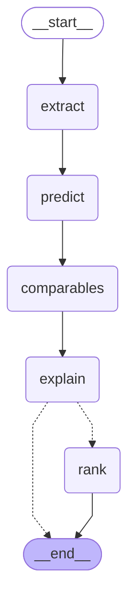
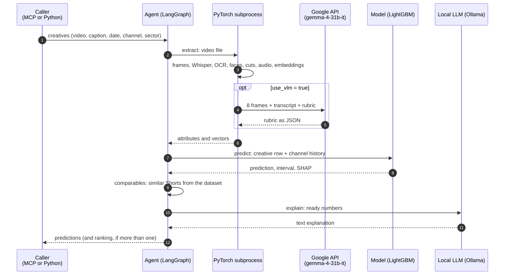

# LangGraph agent

[Português](agent.md) · English

The agent receives one or more creatives that have not been published yet and returns, for each one, the like prediction, the 80% interval, the low-confidence flag, the factors that weighed the most, comparable Shorts and a natural language explanation; with more than one creative, it also returns the ranking.

The number always comes from the trained model. The LLM only writes the explanation from values already computed and cannot change them. Without the LLM, without the video or without the extractor rubric, the agent keeps working, with less information.

Code: `creative_predictor.agent.graph`. The whole system is described in [`architecture.en.md`](architecture.en.md).

## The graph

One node per tool, in a fixed flow. The diagram below is generated from the compiled graph (`uv run python -m creative_predictor.agent.graph --mermaid`), and a test checks that it stays equal to the code.

<!-- grafo:inicio -->

<!-- grafo:fim -->

The dashed edge is conditional: with one creative, the graph ends after the explanation; with two or more, it goes through the ranking.

The flow is fixed on purpose. An agent that decides on its own which tools to call may skip the extraction or answer without consulting the model; here, every prediction goes through the same steps, and the LLM only comes in where language is needed.

## State

The state is a `TypedDict` (`AgentState`) that each node reads and updates:

| Field | Type | Written by | Content |
|---|---|---|---|
| `inputs` | `list[CreativeInput]` | the caller | Creatives to evaluate (contract in `predict.schemas`) |
| `media` | `list[dict \| None]` | `extract` | Video attributes of each creative; `None` without a file |
| `predictions` | `list[Prediction]` | `predict`, `comparables`, `explain` | Predictions, filled in at each node |
| `ranking` | `Ranking \| None` | `rank` | Ordered creatives and the comparison in text |

## Nodes and tools

| Node | Tool | What it does | Without the resource |
|---|---|---|---|
| `extract` | Attribute extraction | For each creative with a video, runs the same steps as the training dataset: frames, transcript (faster-whisper), video and audio signals (faces, on-screen text, cuts, color, motion, volume), embeddings (EmbeddingGemma 2) and, if `use_vlm` is true, the `gemma-4-31b-it` rubric | Without video, the fields stay empty; without the rubric (not requested, no key, or no answer within 15 min), the prediction uses the signals and embeddings |
| `predict` | Prediction and explainability | Builds the creative's row with the channel history, queries LightGBM (prediction, P10, P90 and conformal margin, larger for risky Shorts), computes the factors with SHAP and the low-confidence reasons | Channel without history: uses the median of all the channel's Shorts or of the sector, and flags low confidence |
| `comparables` | History and comparables | Finds real Shorts in the dataset with a similar title, from the same channel and the sector, published before the planned date, with their observed performance | Without the local dataset, the list is empty |
| `explain` | Explanation | The local LLM (`gemma4:12b`) writes up to 5 sentences from the numbers already computed | Without Ollama, the default text stays |
| `rank` | Ranking | Orders by predicted performance relative to the channel and, with the LLM, compares the creatives taking the intervals into account | Without the LLM, a default sentence with the best creative |

Extraction has its own node for two reasons: whoever inspects the result sees what went into the prediction (`attributes` and `blocks_used` in the output), and the video is processed only once, even if the prediction is redone.

## A prediction, step by step



Extraction runs in a subprocess (`predict.worker`) because, on macOS, PyTorch (OCR and embeddings) and LightGBM don't coexist in the same process. The subprocess keeps the models loaded between calls and talks through JSON lines.

## What the LLM receives

For each creative, a JSON built by the agent (`_summary`), with already computed values only:

- predicted likes, 80% interval and times the channel median;
- band (below, average, above, viral) and the low-confidence flag with its reasons;
- the 5 factors that weighed the most, with the direction of the effect and the value when it reads directly (duration, hour, rubric scores);
- the attributes extracted from the video (signals and rubric, with readable names);
- up to 3 comparables with their observed performance.

The instruction asks for Portuguese, at most 5 sentences, no lists, and forbids inventing or changing numbers. Embedding components do not appear one by one: the contributions of each embedding are summed into a readable factor ("overall look of the frames", "audio track", "speech content", "title topic"). Empty video fields are also summed into a single factor ("video not provided", or "video measures without a value" when the video exists but, for example, has no speech), so the explanation does not cite measures that don't exist.

## Input and output

Validated with Pydantic (`predict.schemas`). Input, per creative:

| Field | Required | Use |
|---|---|---|
| `caption` | yes | Planned title or caption |
| `planned_datetime` | yes | Planned date and time; without a time zone, the channel's local time applies |
| `channel` | yes | `channel_id` (history from the dataset or from the YouTube API) or a given `history` |
| `sector` | yes | `moda`, `beleza` or `automotivo` |
| `creative` | no | Path to the video on the machine running the prediction, or an `http(s)` URL, including YouTube links (downloaded before extraction) |
| `use_vlm` | no (false) | Allows sending frames and transcript to Google's API for the rubric |
| `description`, `tags`, `category_id`, `duration_s`, `creative_id` | no | Planned metadata and a name for the ranking |

Output (`Prediction`), per creative: `predicted_metric`, `interval_low`, `interval_high`, `relative_to_channel`, `band`, `channel_median_likes`, `confidence_flag` and `confidence_reasons`, `top_drivers`, `explanation`, `comparables`, `blocks_used`, `attributes` and `notes`. With more than one creative, `Ranking` holds the ordered list and the comparison in text.

## How to call it

Python function:

```python
from creative_predictor.agent.graph import analyze

ranking = analyze([creative_a, creative_b])  # CreativeInput
```

MCP server (`creative_predictor.mcp_server`, FastMCP, stdio or HTTP):

| Tool | Uses the graph | What for |
|---|---|---|
| `predict_creative` | no | One creative, without LLM (faster) |
| `rank_creatives` | no | Several creatives ordered, without LLM |
| `analyze_creatives` | yes | The full agent, with extraction, comparables, explanation and ranking |

## Configuration

| Variable | Default | Effect |
|---|---|---|
| `CREATIVE_PREDICTOR_LLM` | `gemma4:12b` | Ollama model that writes the explanations |
| `GEMINI_API_KEY` | none | Needed only for the rubric (`use_vlm`) |
| `YOUTUBE_API_KEY` | none | Needed only for channels outside the dataset without a given history; without it (or if the API fails), the prediction comes without the channel history and flagged as low confidence |

## Guarantees

- The number never comes from the LLM; the explanation is written after the prediction and does not go back into the model.
- The same code builds the features in training and in prediction; the creative enters as one more row in the channel history.
- A creative's video only leaves the machine with `use_vlm` set to true.
- Each step without its resource (LLM, video, rubric, local dataset, YouTube key) has a fallback path and a note in the output.
