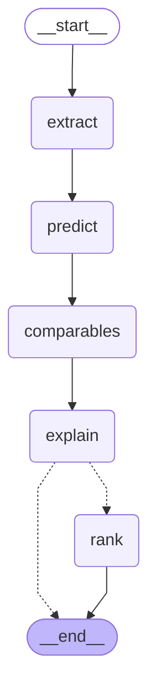
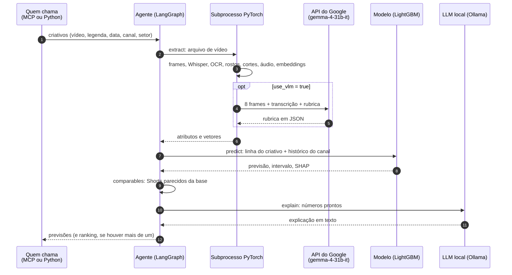

# Agente em LangGraph

Português · [English](agent.en.md)

O agente recebe um ou mais criativos ainda não publicados e devolve, para cada um, a previsão de curtidas, o intervalo de 80%, o sinal de baixa confiança, os fatores que mais pesaram, Shorts comparáveis e uma explicação em linguagem natural; com mais de um criativo, devolve também o ranking.

O número sempre vem do modelo treinado. O LLM só escreve a explicação a partir de valores já calculados e não pode alterá-los. Sem o LLM, sem o vídeo ou sem a rubrica do extrator, o agente continua funcionando, com menos informação.

Código: `creative_predictor.agent.graph`. Visão do sistema inteiro em [`architecture.md`](architecture.md).

## O grafo

Um nó por ferramenta, em fluxo fixo. O diagrama abaixo é gerado do grafo compilado (`uv run python -m creative_predictor.agent.graph --mermaid`), e um teste confere que ele continua igual ao código.

<!-- grafo:inicio -->

<!-- grafo:fim -->

A aresta tracejada é condicional: com um criativo, o grafo termina depois da explicação; com dois ou mais, passa pelo ranking.

O fluxo é fixo de propósito. Um agente que decide sozinho quais ferramentas chamar pode pular a extração ou responder sem consultar o modelo; aqui, toda previsão passa pelas mesmas etapas, e o LLM entra só onde precisa de linguagem.

## Estado

O estado é um `TypedDict` (`AgentState`) que cada nó lê e atualiza:

| Campo | Tipo | Escrito por | Conteúdo |
|---|---|---|---|
| `inputs` | `list[CreativeInput]` | quem chama | Criativos a avaliar (contrato em `predict.schemas`) |
| `media` | `list[dict \| None]` | `extract` | Atributos do vídeo de cada criativo; `None` sem arquivo |
| `predictions` | `list[Prediction]` | `predict`, `comparables`, `explain` | Previsões, completadas a cada nó |
| `ranking` | `Ranking \| None` | `rank` | Criativos ordenados e a comparação em texto |

## Nós e ferramentas

| Nó | Ferramenta | O que faz | Sem o recurso |
|---|---|---|---|
| `extract` | Extração de atributos | Para cada criativo com vídeo, roda os mesmos passos da base de treino: frames, transcrição (faster-whisper), sinais do vídeo e do áudio (rostos, texto na tela, cortes, cor, movimento, volume), embeddings (EmbeddingGemma 2) e, se `use_vlm` for verdadeiro, a rubrica do `gemma-4-31b-it` | Sem vídeo, os campos ficam vazios; sem a rubrica (não pedida, sem chave ou sem resposta em 15 min), a previsão sai com os sinais e os embeddings |
| `predict` | Predição e explicabilidade | Monta a linha do criativo com o histórico do canal, consulta a LightGBM (previsão, P10, P90 e folga conformal, maior nos Shorts de risco), calcula os fatores com SHAP e os motivos de baixa confiança | Canal sem histórico: usa a mediana de todos os Shorts do canal ou do setor, e marca baixa confiança |
| `comparables` | Histórico e comparáveis | Busca Shorts reais da base com título parecido, do mesmo canal e do setor, com o desempenho observado | Sem a base local, a lista sai vazia |
| `explain` | Explicação | O LLM local (`gemma4:12b`) escreve até 5 frases a partir dos números já calculados | Sem o Ollama, fica o texto padrão |
| `rank` | Ordenação | Ordena pelo desempenho previsto em relação ao canal e, com o LLM, compara os criativos levando em conta os intervalos | Sem o LLM, uma frase padrão com o melhor criativo |

A extração fica num nó próprio por dois motivos: quem inspeciona o resultado vê o que entrou na previsão (`attributes` e `blocks_used` na saída), e o vídeo é processado uma vez só, mesmo que a previsão seja refeita.

## Uma previsão, passo a passo



A extração roda num subprocesso (`predict.worker`) porque, no macOS, o PyTorch (OCR e embeddings) e a LightGBM não convivem no mesmo processo. O subprocesso mantém os modelos carregados entre chamadas e conversa por linhas JSON.

## O que o LLM recebe

Para cada criativo, um JSON montado pelo agente (`_summary`), só com valores já calculados:

- curtidas previstas, intervalo de 80% e vezes a mediana do canal;
- faixa (abaixo, na média, acima, viral) e o sinal de baixa confiança com os motivos;
- os 5 fatores que mais pesaram, com o sentido do efeito e o valor quando ele tem leitura direta (duração, hora, notas da rubrica);
- os atributos extraídos do vídeo (sinais e rubrica, com nomes legíveis);
- até 3 comparáveis com o desempenho observado.

A instrução pede português, no máximo 5 frases, sem listas, e proíbe inventar ou alterar números. Componentes de embedding não aparecem um a um: as contribuições de cada embedding são somadas num fator legível ("visual geral dos frames", "trilha de áudio", "conteúdo da fala", "tema do título"). Campos de vídeo vazios também somam num fator só ("vídeo não informado", ou "medidas do vídeo sem valor" quando o vídeo existe mas, por exemplo, não tem fala), para a explicação não citar medidas que não existem.

## Entrada e saída

Validadas com Pydantic (`predict.schemas`). Entrada, por criativo:

| Campo | Obrigatório | Uso |
|---|---|---|
| `caption` | sim | Título ou legenda planejada |
| `planned_datetime` | sim | Data e hora previstas; sem fuso, vale o horário local do canal |
| `channel` | sim | `channel_id` (histórico da base ou da API do YouTube) ou `history` informado |
| `sector` | sim | `moda`, `beleza` ou `automotivo` |
| `creative` | não | Caminho do arquivo de vídeo |
| `use_vlm` | não (falso) | Autoriza enviar frames e transcrição à API do Google para a rubrica |
| `description`, `tags`, `category_id`, `duration_s`, `creative_id` | não | Metadados planejados e um nome para o ranking |

Saída (`Prediction`), por criativo: `predicted_metric`, `interval_low`, `interval_high`, `relative_to_channel`, `band`, `channel_median_likes`, `confidence_flag` e `confidence_reasons`, `top_drivers`, `explanation`, `comparables`, `blocks_used`, `attributes` e `notes`. Com mais de um criativo, `Ranking` traz a lista ordenada e a comparação em texto.

## Como chamar

Função Python:

```python
from creative_predictor.agent.graph import analyze

ranking = analyze([criativo_a, criativo_b])  # CreativeInput
```

Servidor MCP (`creative_predictor.mcp_server`, FastMCP, stdio ou HTTP):

| Ferramenta | Usa o grafo | Para quê |
|---|---|---|
| `predict_creative` | não | Um criativo, sem LLM (mais rápido) |
| `rank_creatives` | não | Vários criativos ordenados, sem LLM |
| `analyze_creatives` | sim | O agente completo, com extração, comparáveis, explicação e ranking |

## Configuração

| Variável | Padrão | Efeito |
|---|---|---|
| `CREATIVE_PREDICTOR_LLM` | `gemma4:12b` | Modelo do Ollama que escreve as explicações |
| `GEMINI_API_KEY` | — | Necessária só para a rubrica (`use_vlm`) |
| `YOUTUBE_API_KEY` | — | Necessária só para canais fora da base sem histórico informado |

## Garantias

- O número nunca vem do LLM; a explicação é escrita depois da previsão e não volta para o modelo.
- O mesmo código monta as features no treino e na previsão; o criativo entra como mais uma linha no histórico do canal.
- O vídeo de um criativo só sai da máquina com `use_vlm` verdadeiro.
- Cada etapa sem recurso (LLM, vídeo, rubrica, base local, chave do YouTube) tem um caminho alternativo e um aviso na saída.
