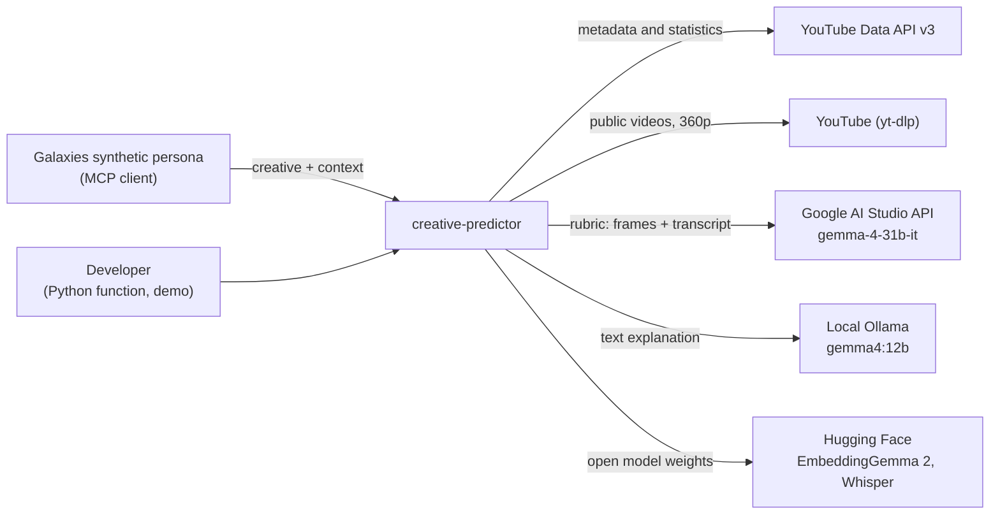
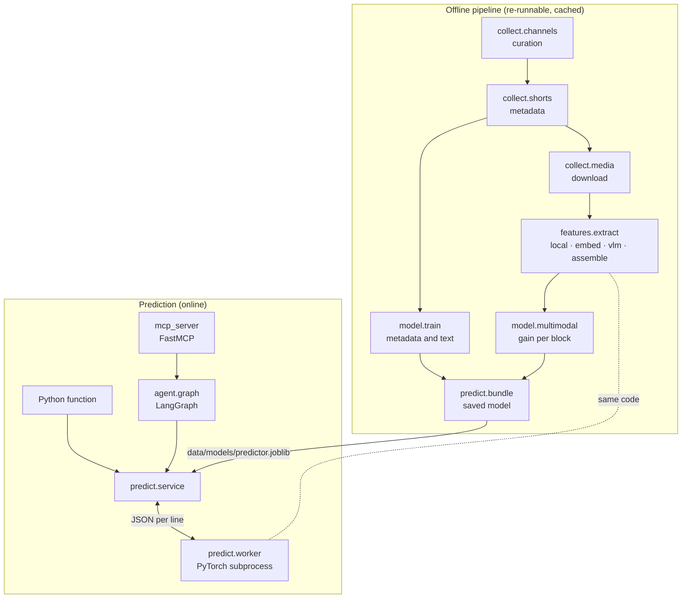
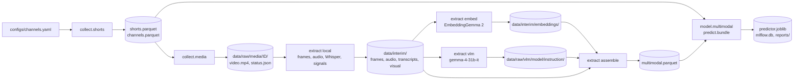

# Architecture

[Português](architecture.md) · English

How the system is organized, why it is this way, and where each part lives. For the agent in detail, see [`agent.en.md`](agent.en.md); for the dataset, [`dataset.en.md`](dataset.en.md).

## Overview

The problem: given a fashion, beauty or automotive YouTube Short that has not been published yet, predict how many likes it will get relative to its own channel's history, with a margin of error and an explanation.

The solution has two halves that share the same feature code:

- **Offline**: collects real Shorts through the YouTube API, downloads the videos, extracts attributes (text, video and audio signals, embeddings, a vision model rubric), trains and evaluates a LightGBM model, and saves the ready model.
- **Online**: receives a new creative, extracts the same attributes, builds the feature row as if the creative were one more Short of the channel, queries the model, and returns prediction, interval, factors, comparables and explanation, as a Python function or an MCP server.

The LLM appears only at the end of the online path, to write the explanation. It never computes the number.

## Context

Who uses the system and which external services it depends on:

At prediction time, Ollama is used when available, the YouTube API only when the channel is not in the dataset, and Google's only when `use_vlm` allows it.

## Containers

| Container | Responsibility | Technology |
|---|---|---|
| Collection | Channel curation and validation, each channel's Shorts playlist, video download | google-api-python-client, yt-dlp |
| Extraction | Frames, audio, transcript, signals, embeddings, rubric; all cached per video | ffmpeg, faster-whisper, OpenCV (YuNet), EasyOCR, EmbeddingGemma 2, Gemma 4 31B |
| Modeling | Feature table, splits, baselines, experiments, calibrated interval | pandas, LightGBM, scikit-learn, MLflow |
| Saved model | Everything the prediction needs besides the code | joblib |
| Prediction | Pydantic contract, feature building, SHAP, comparables | Pydantic, LightGBM |
| PyTorch subprocess | Embeddings and video extraction for a new creative | sentence-transformers, EasyOCR, faster-whisper |
| Agent and MCP | Graph orchestration, explanation, ranking, exposure as a tool | LangGraph, langchain-ollama, FastMCP |

## Offline pipeline

The extraction stages run in parallel and follow the download (`--follow`). They all use the same fixed shuffled order of videos, so stopping before the end leaves a representative sample of every channel.

## Code map

Package `creative_predictor` (in `src/`):

- `config`: project root, data folders and keys from `.env`.
- `files`: atomic writes and hash-checked downloads (published model and YuNet).
- `collect`:
  - `youtube`: API client with cache and quota counter;
  - `channels`: curation and validation, exporting `configs/channels.yaml`;
  - `shorts`: collection of the Shorts and of the multimodal sample;
  - `media`: download with yt-dlp, shuffled order and pauses against blocking.
- `features`:
  - `target`: the channel-relative target;
  - `history`: channel history with posts older than 30 days only, plus the stale-history and declining-channel rules;
  - `local_time`: the channel's time zone;
  - `text`: counts and title embedding;
  - `frames`, `transcribe`, `visual`, `media_embed`: the extraction stages;
  - `rubric` and `vlm`: the Pydantic rubric and the extractors;
  - `vlm_benchmark`: the extractor choice;
  - `extract`: the orchestrator.
- `model`:
  - `dataset`: feature table and splits;
  - `metrics`: metrics and conformal calibration;
  - `train`: baselines and metadata and text experiments;
  - `multimodal`: gain per block and the functions that prepare the video columns, also used at prediction time;
  - `confidence`: validation of the low-confidence rules and of the risk margin;
  - `model_choice`: the choice of algorithm and loss, and the month-by-month performance on the test set;
  - `llm_baseline`: the comparison with an LLM without a model.
- `predict`:
  - `schemas`: contract;
  - `bundle`: saved model;
  - `service`: the prediction function;
  - `source`: the creative's video as a local path (downloads URLs, YouTube included);
  - `media`: video extraction for a new creative;
  - `worker`: the PyTorch subprocess.
- `agent.graph`: the agent; `agent.faithfulness`: the automatic check of the explanations.
- `mcp_server`: the MCP server.
- `demo`: the "before and after" test with channels outside training.
- `app`: Streamlit demo screen (optional `app` dependency), on top of the same prediction function and agent.

Outside the package:
- `configs/`: channel list;
- `notebooks/`: exploratory analysis and results (importing from `src/`);
- `reports/`: aggregated results;
- `tests/`: pytest;
- `docs/`: this documentation.

## Invariants

Rules the code keeps that do not show up when reading a single file:

- **The number comes from the model.** The LLM receives ready values and only writes text; nothing it produces goes back into the prediction.
- **Nothing from the future enters the features.** The channel history only uses Shorts published at least 30 days before the target. Views are never a feature, and subscribers (those on the collection date) only enter a baseline.
- **Training and prediction use the same code.** The new creative enters as one more row in the channel history and goes through `model.dataset.build_table`; the video goes through `features.extract.run_local` and `media_record`, and the columns through `model.multimodal.media_columns` and `add_media_embeddings`, with the PCAs fitted in training.
- **A single extractor for the whole dataset.** Mixing vision models would make the model learn "which extractor answered". The extractor's instruction is versioned (`prompt_id`) and is part of the cache path.
- **LightGBM and PyTorch are never in the same process.** On macOS, the two `libomp` builds crash the interpreter; that is why `predict.worker` imports nothing that loads LightGBM.
- **No stage redoes work.** Each result is cached per video, with atomic writes (temporary file and swap), and only valid responses enter the cache.
- **A creative's video only leaves the machine with permission** (`use_vlm`).
- **The repository does not redistribute data.** Media, API responses and collected tables stay in `data/`, outside git.

## Boundaries

| Boundary | Between | Format |
|---|---|---|
| MCP | Galaxies' persona and the system | Tools with Pydantic input and output |
| Subprocess | `predict.service` and `predict.worker` | One JSON line per request and per response |
| External APIs | System and YouTube / Google | HTTP with cache, token limit and retries on 429, 500 and 503 |
| Saved model | Offline pipeline and prediction | `data/models/predictor.joblib` (LightGBMs, PCAs, bands, conformal margins, feature list) |

## Cross-cutting concerns

- **Configuration**: `config.py` resolves the project root (the `CREATIVE_PREDICTOR_ROOT` variable, a folder with `pyproject.toml`, or the current directory) and reads the keys from `.env`; a blank value counts as missing.
- **Failures**: extraction logs each error in `data/interim/extract_errors.jsonl` and moves on; a video that fails twice does not come back in the same run.
- **Experiments**: MLflow in `mlflow.db` (SQLite at the root) and summaries in `reports/*.csv`.
- **Reproducibility**: dependencies locked in `uv.lock`, Python 3.12, fixed seeds, extraction order fixed by the hash of the video id.
- **Quality**: pytest with API simulators (`tests/fakes.py`) and CI on GitHub Actions (lock, ruff, tests).

## Architecture decisions

A short record of the decisions that shape the system (context, decision and consequence).

| Decision | Context | Consequence |
|---|---|---|
| Channel-relative target: `log((likes+1)/(median+1))` | Channel size dominates likes; Galaxies' decision is between creatives of the same channel | Predictions comparable across channels; the absolute value comes back through the channel median |
| Likes, not views | Shorts views changed definition on 03/31/2025 and include paid media on brand channels | Channels that hide likes are left out |
| History only with posts older than 30 days | The collected likes are today's; recent posts are still growing | The prediction sees the channel as it would be at publishing time |
| A single model with every block, empty fields allowed | Only part of the dataset has extracted video; a creative may come without video or without rubric | The same model serves all three cases; the gain of each block is measured separately |
| Extractor `gemma-4-31b-it` | Best agreement with the reference in the 28-Short benchmark, and open weights | The dataset and the prediction use the free API; with open weights, confidential creatives could use the same model locally (not implemented yet) |
| EmbeddingGemma 2 for title, frames, audio and transcript | An open model with text, image and audio in the same space | One dependency instead of separate CLIP/SigLIP, CLAP and sentence-transformers |
| Quantile interval + conformal calibration | LightGBM quantiles covered 75% instead of 80% | 79% coverage on the test set and 78% on unseen channels (metadata and text model) |
| History risk flag with its own margin | On channels with stale history (reference older than 180 days) or declining, the error is much larger | These Shorts are flagged as low confidence and get an interval calibrated on them only (group coverage from 72% to 78%); thresholds were chosen on validation |
| Fixed flow in the agent | The brief requires the number to come from the model and the evidence to be inspectable | Every prediction goes through the same tools; the LLM only explains |
| Subprocess for PyTorch | `libomp` conflict between LightGBM and PyTorch on macOS | One more process, with models loaded once |
| Everything local and free | Zero budget | Free tiers and open models; the quota limit set the extraction volume |

## Where the artifacts live

| Path | Content | In git |
|---|---|---|
| `configs/channels.yaml` | Training and demo channels | yes |
| `data/raw/youtube_collection/<date>/` | YouTube API responses (cache) | no |
| `data/processed/shorts.parquet`, `channels.parquet` | Collected dataset | no |
| `data/raw/media/<id>/` | Video, thumbnail and download status | no |
| `data/interim/{frames,audio,transcripts,visual,embeddings}/` | Local extraction and embedding outputs | no |
| `data/raw/vlm/<model>/<instruction>/` | Extractor responses | no |
| `data/processed/multimodal.parquet` | Multimodal attributes, one Short per row | no |
| `data/models/` | Saved model, YuNet, EasyOCR | no |
| `mlflow.db`, `mlartifacts/` | Experiment tracking | no |
| `reports/` | Aggregated results and demo | yes |
