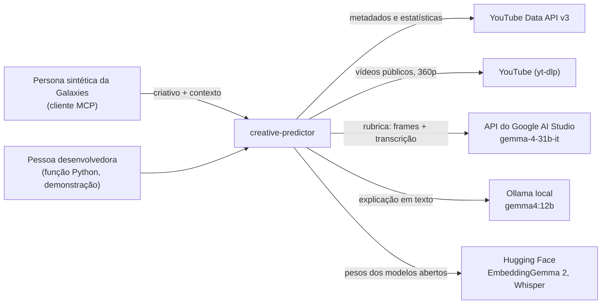
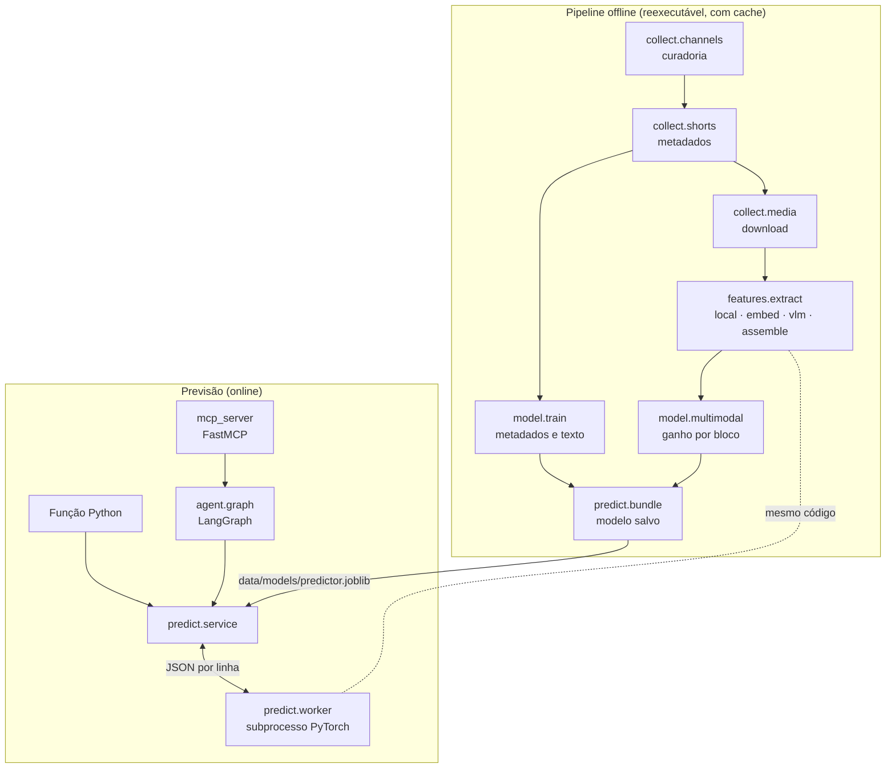
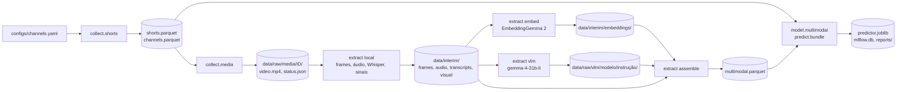

# Arquitetura

Português · [English](architecture.en.md)

Como o sistema está organizado, por que está assim e onde fica cada parte. Para o agente em detalhe, ver [`agent.md`](agent.md); para a base, [`dataset.md`](dataset.md).

## Visão geral

O problema: dado um YouTube Short de moda, beleza ou automotivo ainda não publicado, prever quantas curtidas ele terá em relação ao histórico do próprio canal, com margem de erro e explicação.

A solução tem duas metades que compartilham o mesmo código de features:

- **Offline**: coleta Shorts reais pela API do YouTube, baixa os vídeos, extrai atributos (texto, sinais do vídeo e do áudio, embeddings, rubrica de um modelo de visão), treina e avalia um modelo LightGBM e salva o modelo pronto.
- **Online**: recebe um criativo novo, extrai os mesmos atributos, monta a linha de features como se o criativo fosse mais um Short do canal, consulta o modelo e devolve previsão, intervalo, fatores, comparáveis e explicação, como função Python ou servidor MCP.

O LLM aparece só no fim do caminho online, para escrever a explicação. Ele nunca calcula o número.

## Contexto

Quem usa o sistema e de que serviços externos ele depende:

Na previsão, o Ollama entra quando está disponível, a API do YouTube só quando o canal não está na base, e a do Google só quando `use_vlm` autoriza.

## Contêineres

| Contêiner | Responsabilidade | Tecnologia |
|---|---|---|
| Coleta | Curadoria e validação de canais, Shorts da playlist de cada canal, download dos vídeos | google-api-python-client, yt-dlp |
| Extração | Frames, áudio, transcrição, sinais, embeddings, rubrica; tudo em cache por vídeo | ffmpeg, faster-whisper, OpenCV (YuNet), EasyOCR, EmbeddingGemma 2, Gemma 4 31B |
| Modelagem | Tabela de features, splits, baselines, experimentos, intervalo calibrado | pandas, LightGBM, scikit-learn, MLflow |
| Modelo salvo | Tudo o que a previsão precisa além do código | joblib |
| Previsão | Contrato Pydantic, montagem das features, SHAP, comparáveis | Pydantic, LightGBM |
| Subprocesso PyTorch | Embeddings e extração do vídeo de um criativo novo | sentence-transformers, EasyOCR, faster-whisper |
| Agente e MCP | Orquestração em grafo, explicação, ranking, exposição como ferramenta | LangGraph, langchain-ollama, FastMCP |

## Pipeline offline

As etapas da extração rodam em paralelo e acompanham o download (`--follow`). Todas seguem a mesma ordem embaralhada e fixa dos vídeos, então uma parada antes do fim deixa uma amostra representativa de todos os canais.

## Mapa do código

Pacote `creative_predictor` (em `src/`):

- `config`: raiz do projeto, pastas de dados e chaves do `.env`.
- `files`: escrita atômica e download conferido por hash (modelo publicado e YuNet).
- `collect`:
  - `youtube`: cliente da API com cache e contador de cota;
  - `channels`: curadoria e validação, exportando `configs/channels.yaml`;
  - `shorts`: coleta dos Shorts e da amostra multimodal;
  - `media`: download com yt-dlp, ordem embaralhada e pausas contra bloqueio.
- `features`:
  - `target`: o alvo relativo ao canal;
  - `history`: histórico do canal só com posts de 30+ dias, e as regras de histórico desatualizado e de canal em queda;
  - `local_time`: fuso do canal;
  - `text`: contagens e embedding do título;
  - `frames`, `transcribe`, `visual`, `media_embed`: as etapas da extração;
  - `rubric` e `vlm`: a rubrica Pydantic e os extratores;
  - `vlm_benchmark`: a escolha do extrator;
  - `extract`: o orquestrador.
- `model`:
  - `dataset`: tabela de features e splits;
  - `metrics`: métricas e calibração conformal;
  - `train`: baselines e experimentos de metadados e texto;
  - `multimodal`: ganho por bloco e as funções que preparam as colunas do vídeo, usadas também na previsão;
  - `confidence`: validação das regras de baixa confiança e da folga de risco;
  - `llm_baseline`: a comparação com um LLM sem modelo.
- `predict`:
  - `schemas`: contrato;
  - `bundle`: modelo salvo;
  - `service`: a função de previsão;
  - `media`: extração do vídeo de um criativo novo;
  - `worker`: o subprocesso PyTorch.
- `agent.graph`: o agente; `agent.faithfulness`: a checagem automática das explicações.
- `mcp_server`: o servidor MCP.
- `demo`: o teste "de-para" com canais fora do treino.
- `app`: tela de demonstração em Streamlit (dependência opcional `app`), sobre a mesma função de previsão e o mesmo agente.

Fora do pacote:
- `configs/`: lista de canais;
- `notebooks/`: análise exploratória e resultados (importam de `src/`);
- `reports/`: resultados agregados;
- `tests/`: pytest;
- `docs/`: esta documentação.

## Invariantes

Regras que o código mantém e que não aparecem lendo um arquivo só:

- **O número vem do modelo.** O LLM recebe valores prontos e só escreve texto; nada do que ele produz volta para a previsão.
- **Nada do futuro entra nas features.** O histórico do canal só usa Shorts publicados pelo menos 30 dias antes do alvo. Views nunca são feature, e inscritos (os do dia da coleta) só entram numa baseline.
- **Treino e previsão usam o mesmo código.** O criativo novo entra como mais uma linha no histórico do canal e passa por `model.dataset.build_table`; o vídeo passa por `features.extract.run_local` e `media_record`, e as colunas por `model.multimodal.media_columns` e `add_media_embeddings`, com os PCAs ajustados no treino.
- **Um único extrator para a base inteira.** Misturar modelos de visão faria o modelo aprender "qual extrator respondeu". A instrução do extrator é versionada (`prompt_id`) e faz parte do caminho do cache.
- **A LightGBM e o PyTorch nunca no mesmo processo.** No macOS, as duas `libomp` derrubam o interpretador; por isso `predict.worker` não importa nada que carregue a LightGBM.
- **Nenhuma etapa refaz trabalho.** Cada resultado fica em cache por vídeo, com escrita atômica (arquivo temporário e troca), e só respostas válidas entram no cache.
- **O vídeo de um criativo só sai da máquina com autorização** (`use_vlm`).
- **O repositório não redistribui dados.** Mídia, respostas da API e tabelas coletadas ficam em `data/`, fora do git.

## Fronteiras

| Fronteira | Entre | Formato |
|---|---|---|
| MCP | Persona da Galaxies e o sistema | Ferramentas com entrada e saída Pydantic |
| Subprocesso | `predict.service` e `predict.worker` | Uma linha JSON por pedido e por resposta |
| APIs externas | Sistema e YouTube / Google | HTTP com cache, limite de tokens e novas tentativas em 429, 500 e 503 |
| Modelo salvo | Pipeline offline e previsão | `data/models/predictor.joblib` (LightGBMs, PCAs, faixas, folgas conformais, lista de features) |

## Preocupações transversais

- **Configuração**: `config.py` resolve a raiz do projeto (variável `CREATIVE_PREDICTOR_ROOT`, pasta com `pyproject.toml` ou diretório atual) e lê as chaves do `.env`; valor em branco conta como ausente.
- **Falhas**: a extração registra cada erro em `data/interim/extract_errors.jsonl` e segue; um vídeo que falha duas vezes não volta na mesma execução.
- **Experimentos**: MLflow em `mlflow.db` (SQLite na raiz) e resumos em `reports/*.csv`.
- **Reprodutibilidade**: dependências travadas no `uv.lock`, Python 3.12, sementes fixas, ordem de extração fixa por hash do id do vídeo.
- **Qualidade**: pytest com simuladores das APIs (`tests/fakes.py`) e CI no GitHub Actions (lock, ruff, testes).

## Decisões de arquitetura

Registro curto das decisões que moldam o sistema (contexto, decisão e consequência).

| Decisão | Contexto | Consequência |
|---|---|---|
| Alvo relativo ao canal: `log((curtidas+1)/(mediana+1))` | O porte do canal domina as curtidas; a decisão da Galaxies é entre criativos do mesmo canal | Previsões comparáveis entre canais; o valor absoluto volta pela mediana do canal |
| Curtidas, não views | Views de Shorts mudaram de definição em 31/03/2025 e incluem mídia paga em canais de marca | Canais que ocultam curtidas ficam de fora |
| Histórico só com posts de 30+ dias | As curtidas da coleta são as de hoje; posts recentes ainda crescem | A previsão vê o canal como ele estaria na hora de publicar |
| Um modelo com todos os blocos, campos vazios permitidos | Só parte da base tem vídeo extraído; um criativo pode chegar sem vídeo ou sem rubrica | O mesmo modelo serve aos três casos; o ganho de cada bloco é medido à parte |
| Extrator `gemma-4-31b-it` | Melhor concordância com a referência no benchmark de 28 Shorts e pesos abertos | A base e a previsão usam a API gratuita; com os pesos abertos, criativos sigilosos poderiam usar o mesmo modelo localmente (ainda não implementado) |
| EmbeddingGemma 2 para título, frames, áudio e transcrição | Modelo aberto com texto, imagem e áudio no mesmo espaço | Uma dependência no lugar de CLIP/SigLIP, CLAP e sentence-transformers separados |
| Intervalo por quantis + calibração conformal | Os quantis da LightGBM cobriam 75% em vez de 80% | Cobertura de 79% no teste e 78% em canais nunca vistos (modelo de metadados e texto) |
| Sinal de risco do histórico com folga própria | Em canais com histórico desatualizado (referência com mais de 180 dias) ou em queda, o erro é bem maior | Esses Shorts saem como de baixa confiança e com um intervalo calibrado só neles (cobertura do grupo de 72% para 78%); os limites foram escolhidos na validação |
| Fluxo fixo no agente | O brief exige que o número venha do modelo e que a evidência seja inspecionável | Toda previsão passa pelas mesmas ferramentas; o LLM só explica |
| Subprocesso para PyTorch | Conflito de `libomp` entre LightGBM e PyTorch no macOS | Um processo a mais, com os modelos carregados uma vez |
| Tudo local e gratuito | Orçamento zero | Free tiers e modelos abertos; o limite de cota definiu o volume da extração |

## Onde ficam os artefatos

| Caminho | Conteúdo | No git |
|---|---|---|
| `configs/channels.yaml` | Canais de treino e de demonstração | sim |
| `data/raw/youtube_collection/<data>/` | Respostas da API do YouTube (cache) | não |
| `data/processed/shorts.parquet`, `channels.parquet` | Base coletada | não |
| `data/raw/media/<id>/` | Vídeo, thumbnail e status do download | não |
| `data/interim/{frames,audio,transcripts,visual,embeddings}/` | Saídas da extração local e dos embeddings | não |
| `data/raw/vlm/<modelo>/<instrução>/` | Respostas do extrator | não |
| `data/processed/multimodal.parquet` | Atributos multimodais, um Short por linha | não |
| `data/models/` | Modelo salvo, YuNet, EasyOCR | não |
| `mlflow.db`, `mlartifacts/` | Registro dos experimentos | não |
| `reports/` | Resultados agregados e demonstração | sim |
